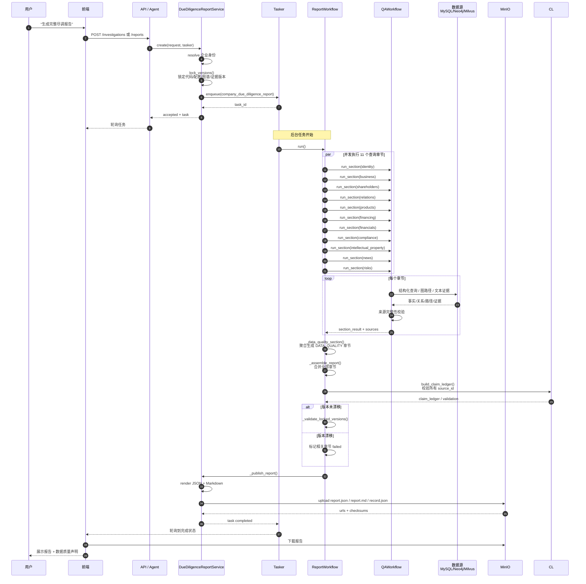

# 企业尽调智能体整体架构与报告生成逻辑

> 未提交到 Git，放在根目录便于查看。Mermaid 图可直接在支持 Mermaid 的 Markdown 阅读器（如 GitHub、GitLab、Typora、VS Code）中渲染。

---

## 一、为什么“企业尽调智能体”既是全局 Agent，又是一个 Tool？

### 双重暴露的目的

| 暴露方式 | 位置 | 作用 | 谁在用 |
|---|---|---|---|
| **全局共享 Agent** | `AgentRepository.ensure_company_due_diligence_agent()` | 用户在前端智能体列表里直接选择“企业尽调智能体”，进入专属对话上下文 | 终端用户 |
| **系统 Tool** | `yuxi/agents/toolkits/company_due_diligence/tools.py::investigate_company` | 其他通用 Agent（如 ChatbotAgent）在需要企业信息时，通过工具调用复用同一套领域能力 | 其他 Agent / Skills |

### 关系说明

- 全局 Agent 的系统提示词（`COMPANY_DUE_DILIGENCE_SYSTEM_PROMPT`）明确告诉它：**“对企业问题必须优先调用 `investigate_company` 工具，不要直接推测企业事实。”**
- `investigate_company` 工具的实现并不是又起一个新的 LangGraph，而是直接调用领域服务 `company_due_diligence_agent.investigate(...)`。
- 因此，**两个入口最终汇聚到同一个领域服务**，既保证了用户体验（有专属 Agent），又保证了能力可复用（被其他 Agent 调用）。

---

## 二、整体架构逻辑图

```mermaid
graph TD
    subgraph 前端层
        UI1[用户选择<br/>企业尽调智能体]
        UI2[用户在其他 Agent 中提问]
    end

    subgraph API层
        R1[/api/company-due-diligence/investigations]
        R2[/api/agent/runs<br/>ChatbotAgent]
    end

    subgraph Agent层
        GA[全局 Agent<br/>company-due-diligence]
        CA[通用 ChatbotAgent<br/>LangGraph]
    end

    subgraph 工具层
        T1[investigate_company Tool]
    end

    subgraph 领域服务层
        S1[CompanyDueDiligenceAgent.investigate]
        ER[EntityResolutionService<br/>企业身份解析]
        IP[InvestigationPlanner<br/>意图/主题/计划]
        QA[CompanyQuestionService<br/>QAWorkflow]
        RP[DueDiligenceReportService<br/>ReportWorkflow]
        CL[ClaimLedger<br/>来源校验]
        DQ[DataQuality<br/>数据质量]
    end

    subgraph 数据源层
        MySQL[(MySQL<br/>只读企业事实)]
        Neo4j[(Neo4j<br/>关系图谱)]
        Milvus[(Milvus<br/>文本证据)]
        MinIO[(MinIO<br/>报告产物)]
    end

    UI1 -->|直接对话| GA
    UI2 -->|自然语言| R2
    R2 --> CA
    CA -->|工具调用| T1
    GA -->|系统提示要求调用| T1
    T1 -->|委托| S1
    R1 -->|直接调用| S1

    S1 --> ER
    S1 --> IP
    IP -->|同步问答| QA
    IP -->|异步报告| RP

    QA -->|17类结构化查询| MySQL
    QA -->|最多3跳路径| Neo4j
    QA -->|文本证据检索| Milvus

    RP -->|每章节复用| QA
    QA --> CL
    RP --> CL
    CL --> DQ

    RP -->|publish| MinIO
    S1 -->|返回| UI1
    S1 -->|返回| CA
    RP -->|task 指针| UI1
```

---

## 三、生成一份企业尽调报告的详细流程



---

## 四、关键设计点

1. **为什么不是 Agent 直接生成报告，而是 Workflow？**
   - 报告需要 12 个章节，每个章节对应不同数据源。如果让单个 LLM 直接写，容易幻觉且无法溯源。
   - 用 `ReportWorkflow` 把每个章节拆成受控的 `CompanyQuestionService.query()` 调用，再聚合结果，保证每个事实都有来源。

2. **版本锁定的作用**
   - 报告生成可能耗时较长，期间如果 Neo4j 图谱或 Milvus 证据索引被更新，会导致前后数据不一致。
   - `lock_versions()` 在创建任务时记录当前派生数据版本，最后 `_validate_locked_versions()` 校验未漂移，否则标记章节失败。

3. **Claim Ledger 的位置**
   - 在 QA 层和 Report 层都执行来源校验：QA 回答每条事实前要校验，Report 聚合全部章节后还要再校验一次。
   - 这是“LLM 不生成无来源企业事实”的核心保障。

4. **Tasker 与 AgentRun 的区别**
   - 报告生成走 **Tasker**（`task_service.py`），运行在 API 进程内的内存队列，适合有终态、可重试的后台任务。
   - AgentRun 走 **ARQ + Worker**，适合长周期、可取消、需要 SSE 的交互式智能体运行。

---

## 五、一句话总结

> 企业尽调智能体以“全局 Agent + 系统 Tool”双重形式暴露，最终都调用同一套领域服务；生成报告时，先锁定企业与数据版本，再并发执行 11 个章节的受控查询，最后经过 Claim Ledger 校验和数据质量聚合，把 JSON/Markdown 产物发布到 MinIO。
