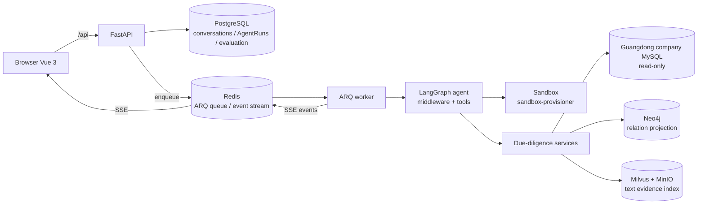
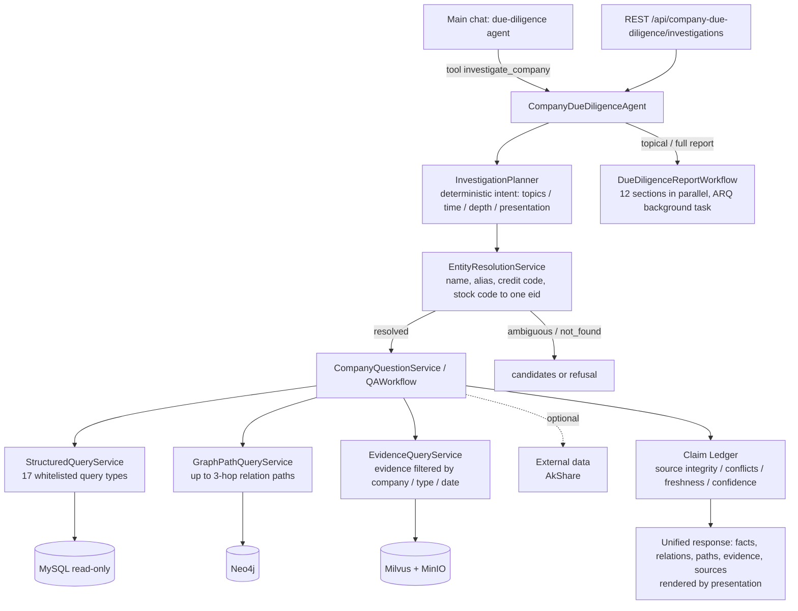

<div align="center">
<h1>Company Relation & Due Diligence Agent</h1>

<p><strong>A Guangdong enterprise due-diligence agent and an agent evaluation system, built on <a href="https://github.com/xerrors/Yuxi">Yuxi</a></strong></p>

[](docker-compose.yml)
[](https://github.com/1yu2/company-relation/issues)
[](LICENSE)

[中文](README.md)

</div>

## What this repository is

This repository adds two things on top of the Yuxi agent platform:

1. **Company due-diligence agent** — answers questions about Guangdong companies (registration, shareholders, relations, risks, financing, IP) in the main chat and produces topical or full due-diligence reports, using an existing MySQL database as a **read-only source of truth**. Every claim must trace back to a source; the LLM never invents company facts.
2. **Agent evaluation system** — a reproducible evaluation loop built into the platform. It runs through the real AgentRun pipeline and supports paired per-task comparison and a regression gate, so changes to an agent (including the due-diligence agent) can be shown to actually help.

Chat, multi-tenancy, model providers, Skills / MCP / sub-agents, the sandbox and knowledge bases come from Yuxi and are only summarized here; see the [documentation site](https://1yu2.github.io/company-relation/).

## Architecture



Chat requests are persisted as AgentRuns and executed by the ARQ worker; run events stream back to the browser over Redis Streams and SSE. Reports, the Neo4j projection, the evidence index and evaluation experiments are background tasks persisted in PostgreSQL and recovered after restarts.

## Due-diligence architecture



- MySQL is the only source of truth: read-only connections, a two-layer SQL guard and whitelisted business queries only. The Neo4j projection and the Milvus evidence index are rebuilt offline from MySQL.
- Amounts, ratios, dates and pagination are handled by deterministic code (for example, registered and paid-in capital are converted from "万元人民币" to base currency units).
- Missing, stale, conflicting or low-confidence results are returned explicitly; failed validation refuses to produce a definitive answer.
- **Current limitation**: the chat agent sees a single `investigate_company` tool and intent is parsed by keyword rules, so it is closer to a deterministic workflow inside a tool than an agent that chooses its own tools; rephrased questions (e.g. "股东情况") can be mis-routed. The planned next step splits the tool into smaller tools, has the LLM produce `InvestigationIntent` (keeping the rules as a counted fallback), gates final answers with the Claim Ledger, and compares against the deterministic baseline on the same Q-02 tasks.

## Agent evaluation

```mermaid
flowchart LR
    DS[Dataset version<br/>immutable once published] --> EXP[Experiment<br/>config snapshot]
    EXP -->|ARQ| JOB[Job<br/>executor lock + concurrency]
    JOB --> RO[Rollouts<br/>committed one by one, resumable]
    RO --> RUN{runner}
    RUN -->|agent_run| AR[Real AgentRun]
    RUN -->|company_due_diligence| CS[Due-diligence service]
    AR --> EVAL[Evaluator by protocol]
    CS --> EVAL
    EVAL --> M[(Metrics / trace / failure attribution)]
    M --> SUM[Experiment summary]
    SUM --> CMP[Paired comparison<br/>McNemar]
    CMP --> GATE[make eval-gate]
    ONL[Online sampling] --> POOL[Failure pool] -->|human review| DS
```



- **Protocols**: code tasks, fault injection, knowledge-base QA (Hit@K / MRR / nDCG@K with failure attribution), open answers judged by a versioned LLM Judge (excluded from pass rates until human-calibrated), and company due diligence.
- **Reproducibility**: each experiment snapshots the resolved model, prompt/config checksums, tools, dataset version, evaluator versions and code checksum; runs pin the snapshot model and refuse to run if an evaluator changed after creation.
- **Comparison and gate**: paired per-task comparison, refused across datasets or scoring versions; `make eval-gate BASE=<id> CANDIDATE=<id>` applies noise-derived thresholds.
- Use the `/evaluation` page and import datasets as described in [scripts/eval/datasets/README.md](scripts/eval/datasets/README.md). Current local baselines with experiment IDs are listed in the [Chinese README](README.md#agent-评测体系); they come from single local runs and are not production accuracy or capacity figures.

## Quick start

Prerequisites: Docker with Docker Compose and at least one OpenAI-compatible LLM API; due diligence also needs a read-only Guangdong company MySQL configured as `MYSQL_URL` in `.env`.

```bash
git clone https://github.com/1yu2/company-relation.git
cd company-relation
./scripts/init.sh          # Windows: .\scripts\init.ps1
docker compose up --build
```

Open `http://localhost:5173`, sign in with the generated admin account, pick the due-diligence agent in the main chat, and open `/evaluation` for evaluations. Run `make verify` before opening a PR; CI runs the same checks. See [ARCHITECTURE.md](ARCHITECTURE.md) for the code map.

## Acknowledgements

- [Yuxi](https://github.com/xerrors/Yuxi) — the platform this project is built on.
- [LangGraph](https://github.com/langchain-ai/langgraph) and [DeepAgents](https://github.com/langchain-ai/deepagents) — agent orchestration.
- [AkShare](https://github.com/akfamily/akshare) — public data supplementation.

## License

MIT — see [LICENSE](LICENSE).
