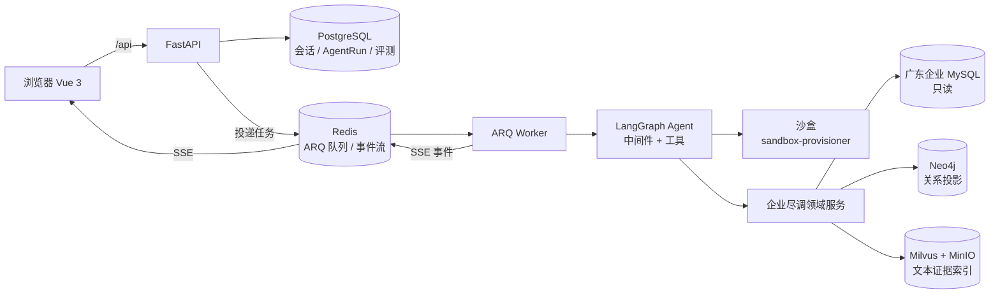
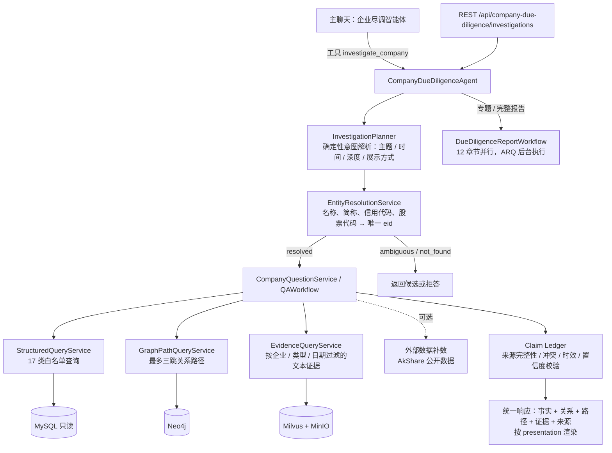
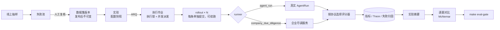

<div align="center">
<h1>企业关系与尽调智能体</h1>

<p><strong>基于 <a href="https://github.com/xerrors/Yuxi">Yuxi（语析）</a> 构建的广东企业尽调智能体与 Agent 评测体系</strong></p>

[](docker-compose.yml)
[](https://github.com/1yu2/company-relation/issues)
[](LICENSE)

[English](README.en.md)

</div>

## 项目定位

本仓库在 Yuxi 智能体平台上做了两件事：

1. **企业尽调智能体**：以现有广东企业 MySQL 作为**只读事实主库**，在主聊天中回答企业工商、股东、关系、风险、融资、知识产权等问题，并生成专题或完整尽调报告。每条结论都必须能回查到来源，LLM 不生成无来源的企业事实。
2. **Agent 评测体系**：平台内置的可复现评测闭环，通过真实的 AgentRun 链路执行，支持逐题对比和回归门禁，用来衡量智能体（包括企业尽调）的改动是否真的变好了。

聊天、多租户、模型供应商、Skills / MCP / 子智能体、沙盒、知识库等通用能力来自 Yuxi，本文只做简述；详细说明见 [项目文档](https://1yu2.github.io/company-relation/)。

## 整体架构



- 所有服务由 Docker Compose 管理，本地开发支持热重载。
- 聊天请求先持久化为 AgentRun，再由 ARQ worker 执行 LangGraph；运行事件经 Redis Stream 通过 SSE 推回前端。
- 报告生成、Neo4j 投影、证据索引和评测实验都是持久化到 PostgreSQL 的后台任务，由同一个 worker 认领执行，进程重启后可以恢复。

## 企业尽调架构



**数据边界**

- MySQL 是唯一事实来源，只读连接、SQL 双层守卫，只允许白名单业务查询，不暴露任意 SQL；不修改、不补充原表。
- Neo4j 关系投影和 Milvus 证据索引都从 MySQL 离线构建（ARQ 后台任务），可以随时重建；Neo4j 在线但没有投影时返回“来源不可用”，不伪装成“没有关系”。
- 金额、比例、日期、分页由确定性代码处理。例如注册资本和实收资本都按源文本中的“万元人民币”换算为基础货币单位。
- 缺失、过期、冲突和低置信度的结论必须显式返回；校验失败时拒绝给出确定结论。

**数据规模**（2026-08-11 只读扫描）：924 家企业，13,171 条股东记录，7,365 条产品，3,409 条融资，999 条行政处罚，196,327 条许可，2,053,965 条专利关系。

**当前实现与限制**（如实说明）

- 主聊天中的智能体只看到一个工具 `investigate_company`（另有外部数据补数工具）。意图解析由关键词规则完成，LLM 实际上只负责转交问题，所以它更接近“工具内的确定性工作流”，还不是自主选择工具的 Agent。
- 因此换一种问法就可能路由失败。例如“股东情况”不会触发股东查询，这正是下面 Q-02 基线中剩余失败的原因。
- 下一步的 Agent 化方案：把大工具拆成实体解析 / 结构化查询 / 关系 / 证据 / 外部数据 / 报告几个小工具，由 LLM 输出 `InvestigationIntent`（关键词规则保留为对照和回退，并计数），以 Claim Ledger 作为最终回答的门禁，再用同一套 Q-02 题与确定性基线逐题对比。

## Agent 评测体系



| 环节 | 能力 |
| --- | --- |
| 数据集 | 版本化，发布后不可修改；未经复核（`pending_review`）的题、期望由被测服务自身输出生成（`source_generated`）的题都不能发布；已发布的版本可以停用 |
| 执行 | 后台 worker 执行，按 `concurrency` 并发；每条 rollout 单独提交，中断后可以续跑；执行锁保证同一实验只有一个执行者；取消会级联中止在途 AgentRun 及其子 Run |
| 评分协议 | 代码题 `agent_final_answer_v1`、故障注入 `agent_fault_recovery_v1`、知识库问答 `agent_rag_answer_v1`（Hit@K / MRR / nDCG@K 与失败归因）、开放式回答 `agent_open_answer_v1`（版本化 LLM Judge，人工校准达标前不计入通过率）、企业尽调 `cdd_q02_review_v1` |
| 指标 | pass@1 / pass@k / pass^k；结果层、检索层、轨迹层通过率；失败恢复率；耗时分位数；token 与成本 |
| 可复现 | 创建实验时记录配置快照（实际模型、prompt 与配置校验和、工具清单、数据集版本、评分器版本、代码校验和）；执行时固定使用快照中的模型；评分器在创建实验后升级则拒绝执行 |
| 对比与门禁 | 两次实验逐题配对，给出修复 / 退化、McNemar 检验和性能差异；数据集或评分口径不同时拒绝对比；`make eval-gate` 按阈值判定能否替换基线 |
| 线上回流 | 按抽样率抽取线上对话，用通用规则（失败、空回答、循环、超预算、工具报错、点踩）筛出可疑样本，进入失败池，人工复核后生成草稿题（默认不抽样） |

**使用方式**

- 页面：`/evaluation`，包含实验列表、指标、逐题回答与工具调用、配置快照、基线对比和失败池。
- 导入数据集：见 [scripts/eval/datasets/README.md](scripts/eval/datasets/README.md)。
- 回归门禁：`make eval-gate BASE=<基线实验 ID> CANDIDATE=<候选实验 ID>`，任一规则失败时退出码非 0。阈值由同配置重复实验的噪声推导，只适用于 `agent_python_tasks_v1`。

**当前基线**（`deepseek:deepseek-v4-flash`，本地 Docker 环境）

| 题集 | 结果 | 实验 |
| --- | --- | --- |
| `agent_python_tasks_v1`（16 题，已人工确认），`default-chatbot` 每题 3 次 | pass@1 85.4%（41/48），pass^3 81.3%，答案值正确率 100%；失败集中在“没有只输出答案”的格式问题 | `pex_ac41bcb1a9633efa776f0eadfe04` |
| 同题集换 `qwen3.7-flash` | 通过率不变（0 修复 / 0 退化），Agent 端到端 P50 增加 70% | `pex_b7fafad784abd613ba0ea709ab07` |
| 并发压测，每组 32 个样本 | 并发 1 / 4 / 8 / 16 时吞吐为 5.9 / 19.7 / 27.2 / 35.2 题/分钟，pass@1 均为 87.5% | `pex_707919b432e935c3588f28c2a050` 等 4 组 |
| 企业尽调 Q-02 v3（36 题），确定性工作流 | pass@1 80.6%（29/36）；实体识别 36/36，拒答 8/8；剩余 7 题失败都是因为关键词路由不认识“股东情况” | `pex_23894b696b5ae6ad943e2011531d` |

这些数字都来自本机上的单次运行，只用于说明评测体系能做什么，不能外推为生产环境的准确率或容量。Q-02 v3 的参考答案由源表只读 SQL 独立生成，**尚未经人工抽查**。知识库问答的真实实验、LLM Judge 的人工校准、故障注入题的确认和线上抽样率还需要提供数据、标注或人工决策。

## 快速开始

**前置要求**：已安装 [Docker](https://docs.docker.com/get-docker/) 与 Docker Compose，并准备至少一个兼容 OpenAI 接口的大模型 API。企业尽调还需要在 `.env` 中配置只读的广东企业 MySQL（`MYSQL_URL`）。

```bash
git clone https://github.com/1yu2/company-relation.git
cd company-relation
./scripts/init.sh          # Windows：.\scripts\init.ps1
docker compose up --build
```

启动完成后打开 `http://localhost:5173`，用初始化时生成的管理员账户登录。在主聊天中选择“企业尽调智能体”即可直接提问；评测页面在 `/evaluation`。不需要知识库或知识图谱时，可以用 `make up-lite` 以轻量模式启动。

**开发与质量门禁**

```bash
make verify
```

`make verify` 在运行中的容器里执行后端单测、Ruff 检查与格式检查、前端单测、ESLint 和生产构建，不会自动修改代码。GitHub Actions 的 CI 运行同一份检查清单，并检查 PR 中的空白字符错误。集成测试需要真实的 PostgreSQL / Redis / MySQL，会读取 `.env` 中的 `TEST_*` 或 `E2E_*` 账号，需要在本地单独运行。测试规范见 [testing-guidelines.md](docs/develop-guides/testing-guidelines.md)，架构代码地图见 [ARCHITECTURE.md](ARCHITECTURE.md)。

## 文档

- 企业尽调：[总体方案](docs/agents/company-due-diligence-system.md) · [实现说明](docs/agents/company-due-diligence-implementation-guide.md) · [全链路与效果论证](docs/agents/company-due-diligence-end-to-end-script.md) · [公开企业关系评测基线](docs/agents/company-relation-evaluation.md)
- 评测：[数据集与回归门禁](scripts/eval/datasets/README.md) · [基于 Langfuse 的智能体评估](docs/agents/agent-evaluation.md)
- 平台：[项目文档站](https://1yu2.github.io/company-relation/) · [变更记录](docs/develop-guides/changelog.md) · [贡献指南](docs/develop-guides/contributing.md)

## 致谢

- [Yuxi（语析）](https://github.com/xerrors/Yuxi)：本项目的平台基础，提供多租户智能体平台、知识库与知识图谱、沙盒和前后端框架。
- [LangGraph](https://github.com/langchain-ai/langgraph)、[DeepAgents](https://github.com/langchain-ai/deepagents)：智能体编排与深度智能体框架。
- [AkShare](https://github.com/akfamily/akshare)：公开数据补数（工商、财务、融资、股东、新闻等主题，默认不参与主查询）。

## 许可证

本项目采用 MIT 许可证，详见 [LICENSE](LICENSE)。
