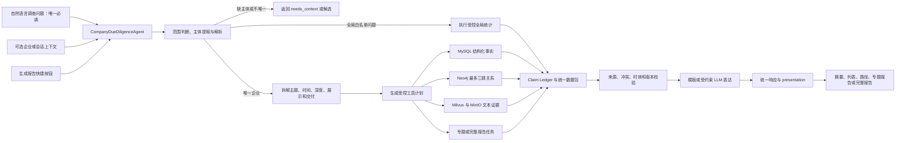

# 企业尽调智能体全链路与效果论证逐字稿

> **历史参考**：本文描述的是 2026-10-22 之前的确定性工作流实现（`InvestigationPlanner`、`investigate_company`、问答工作流、十二章节报告任务链路），这些代码已经移除，现由企业尽调智能体取代，见《[企业尽调智能体](company-due-diligence-system.md)》。

本文不是演示操作手册，而是一份用于方案汇报、技术评审和业务验收的逐字稿。它说明用户从自然语言调查要求开始，系统如何判断全局或企业范围、建立可选企业上下文、理解意图、选择内部工具、校验事实、动态组织输出，并用当前数据和自动化回归说明系统已经证明什么、还不能证明什么。

系统边界见 [企业尽调智能体](./company-due-diligence-system.md)，开发拆解见 [企业尽调智能体实现逐字稿](./company-due-diligence-implementation-guide.md)。

## 一、先给出结论

**逐字稿：**

> 企业尽调不应该要求用户先理解系统内部有简单问答、多跳关系和证据检索三种能力，也不应该要求用户先填写准确企业名称或内部 `eid`。用户真正关心的是“我要了解什么”，企业主体可以直接包含在自然语言问题中；不依赖单一企业的目录覆盖、共同股东等问题还可以直接按全局范围回答。
>
> 因此，企业尽调模块应成为 Yuxi 智能体体系中的唯一全局共享领域智能体 `CompanyDueDiligenceAgent`。用户只表达调查需求，智能体负责识别全局或企业范围、解析问题中的企业、拆解主题和时间范围、规划结构化查询、关系图查询、文本证据或报告任务，最后返回与原始问题一致的结果。只有企业依赖问题缺少唯一主体时，系统才返回 `needs_context` 请求补充信息。
>
> MySQL 是事实主库，Neo4j 是可重建的关系投影，Milvus 和 MinIO 保存企业范围内的文本证据。大模型可以理解意图和优化表达，但不能决定企业 `eid`，也不能生成没有来源的企业事实。
>
> 所以系统的优势不只是“能回答问题”，而是输入意图和最终输出可以对齐，企业主体不会被静默混淆，事实和路径可以回查，来源失败不会被伪装成无数据，核心链路还能通过分层自动化测试持续回归。

## 二、模块在系统中的定位

**逐字稿：**

> 企业尽调不是脱离平台的独立查询工具，而是主聊天中的全局共享领域智能体。当前不提供独立企业尽调工作台。
>
> 主聊天必须使用 slug 为 `company-due-diligence` 的全局 Agent，并通过 `investigate_company` 进入同一个 `CompanyDueDiligenceAgent`。REST 查询和报告接口也复用同一领域服务，不维护第二套调查输入输出。
>
> 领域智能体内部包含企业解析、结构化查询、图路径、证据检索、报告生成和质量校验工具。用户看到的是调查能力，系统内部才看到执行工具。

```text
主聊天企业尽调 Agent ─────── CompanyDueDiligenceAgent
                                      ├── EntityResolutionTool
                                      ├── StructuredQueryTool
                                      ├── GraphPathTool
                                      ├── EvidenceSearchTool
                                      ├── ReportGenerationTool
                                      └── QualityValidationTool
```

## 三、完整链路总览



可编辑流程图位于 `docs/vibe/2026-08-11-company-due-diligence-end-to-end.drawio`。

## 四、第一阶段：用户输入什么

**逐字稿：**

> 普通用户不需要输入数据库 `eid`，也不应该被要求先选择“简单问答”“多跳关系”或“证据检索”。如果用户已经知道准确 `eid` 并能直接访问数据库，智能体的价值反而被削弱了。
>
> `question` 是唯一必填业务输入。用户可以直接问“广东某某股份有限公司的股东有哪些”，也可以在已有会话上下文中问“这家企业近三年的风险是什么”。企业搜索、候选确认和 `company_ref` 都是可选辅助，不能成为页面提交的前置条件。
>
> 用户也可以问“当前数据覆盖哪些企业”或“哪些企业存在共同股东”。这类固定白名单问题不需要单一企业，系统返回 `global_scope`。如果问题必须依赖企业但没有唯一主体，系统返回 `needs_context`；如果问题中出现第二家企业，系统把它作为另一个待解析主体，不能只把名称当作普通关键词。

用户可见输入示例：

```json
{
  "question": "请用报告形式分析广东某某股份有限公司近三年的企业关系和风险",
  "company_ref": null
}
```

报告快捷按钮本质上等价于一条明确的用户意图：

```json
{
  "company_ref": "可选的已确认企业上下文",
  "shortcut": "generate_full_due_diligence_report"
}
```

主聊天不能直接绕到某个数据库查询或独立报告实现，而要进入同一个领域智能体。

## 五、第二阶段：企业上下文如何建立

**逐字稿：**

> 企业搜索的意义不是让用户替系统提供一个准确 `eid`，而是在问题自动解析无法唯一确定主体时提供候选确认。正常路径先从问题中提取企业法律全称、股票代码或信用代码，并将其解析成唯一、稳定、可复用的企业上下文。
>
> 系统可以从企业全称、简称、信用代码或股票代码开始解析，但最终 `eid` 只能由确定性企业解析器确认。大模型可以识别用户提到了哪些名称，不能根据语言相似度直接决定是哪家法律主体。
>
> 如果问题属于固定白名单全局统计，系统不建立单企业上下文，直接返回 `global_scope`。如果企业依赖问题没有主体，返回 `needs_context`；如果出现多个候选，系统只询问一次必要的消歧问题，例如让用户确认地区、标准全称或股票代码。确认完成后，后续的“这家企业”“该公司”都继承同一个企业上下文，不要求重复输入。

解析结果分为：

- `resolved`：唯一主体已解析，可继续查询。
- `global_scope`：问题不依赖单一企业，执行固定白名单全局统计。
- `needs_context`：问题依赖企业，但当前没有唯一主体。
- `ambiguous`：存在多个候选，返回最小必要候选信息等待确认。
- `not_found`：没有找到可用主体。
- `source_unavailable`：企业主数据源不可用，不能伪装成企业不存在。

关系问题中的目标企业使用同样规则。任何未确认主体都不能进入确定性关系结论。

## 六、第三阶段：如何拆解用户意图

**逐字稿：**

> 调查范围确定为 `resolved` 或 `global_scope` 之后，领域智能体不是简单判断一个“问题类型”，而是把用户要求拆成六个维度：调查主体或全局范围、业务主题、时间范围、调查深度、输出形式和交付方式。
>
> 例如“请用报告形式分析这家企业近三年的企业关系和风险”，主体是当前企业，主题是关系和风险，时间范围是近三年，深度是详细，输出形式是专题报告，交付方式因为可能耗时较长而选择异步任务。
>
> 多跳、结构化查询和证据检索不属于这六个业务维度，它们是系统根据意图自动选择的执行策略。

内部统一意图对象：

```json
{
  "entities": [
    {"eid": "内部已确认主体", "role": "primary_company"}
  ],
  "intent": {
    "topics": ["relations", "risks"],
    "presentation": "topic_report",
    "delivery": "async_task",
    "time_scope": {"type": "recent_years", "years": 3},
    "depth": "detailed",
    "evidence_required": true
  },
  "constraints": {
    "hop_limit": 3,
    "include_low_confidence": false
  }
}
```

这个对象是内部编排契约，不是新的复杂前端表单。

## 七、第四阶段：如何生成受控工具计划

**逐字稿：**

> 意图理解完成后，系统生成的是受控工具计划，不是让大模型自由编写 SQL、Cypher 或检索表达式。
>
> “股东有哪些”只调用结构化股东查询；“A 企业和 B 企业有什么关系”调用两个主体解析和图路径工具；“近三年的风险”调用结构化风险查询，并在需要解释时补充文本证据；“关系和风险专题报告”组合图路径、风险、证据和报告工具。
>
> 这样既保证简单问题走短链路，也允许复杂问题由多个工具协作，而用户不需要了解底层差异。

计划必须限制：

- 结构化查询只能使用白名单业务操作。
- 图路径最多三跳，不开放无限遍历。
- 文本检索必须带企业、类型、日期和版本过滤。
- 列表、证据数量和并行度都有固定上限。
- 所有工具失败都返回明确来源状态。

## 八、第五阶段：三类事实链路如何执行

### 8.1 MySQL 结构化事实

**逐字稿：**

> 企业基本信息、股东出资、产品、融资、风险、许可、知识产权和财务指标由只读 MySQL Repository 查询。每一个 Repository 方法都是确定的业务动作，例如查询当前股东，而不是接受任意 SQL。
>
> 返回结果统一规范金额、比例和日期，并带上来源表、稳定记录键、业务日期和查询时间。大模型不负责计算持股比例，也不猜测缺失字段。

### 8.2 Neo4j 多跳关系

**逐字稿：**

> 多跳关系不是让向量检索召回若干相似文本后自行拼接，而是把 MySQL 中可以验证的企业、股东、投资机构和相关关系投影到 Neo4j，再通过受控路径模板查询一到三跳完整路径。
>
> 路径必须返回每个节点、每条边、方向、跳数、置信度和来源。只有名称相同但缺少稳定身份的关系只能作为候选线索，不能进入严格事实答案。
>
> Neo4j 服务在线但没有激活投影时，系统返回 `source_unavailable`；它不能把“图谱没准备好”解释成“两家企业没有关系”。

### 8.3 Milvus 与 MinIO 文本证据

**逐字稿：**

> 行政处罚、环保处罚、许可、专利摘要、产品描述和可唯一映射新闻会生成稳定文档和分块 ID。Milvus 保存版本化向量索引，MinIO 保存原文归档、清单和 checksum。
>
> 查询必须先限定企业，再限定证据类型和日期。文本召回结果还要回连结构化企业和来源记录，否则只能作为未归属候选证据。

## 九、第六阶段：Claim Ledger 如何保证准确率

**逐字稿：**

> 三类工具的结果不会直接交给大模型，而是先合并成 Claim Ledger。每个候选结论都记录主体、谓词、值或关系对象、时间、置信度和来源。
>
> `QualityValidationTool` 会检查企业身份是否一致，事实是否存在来源，关系边是否来自当前投影，证据是否属于当前企业，日期是否满足用户时间范围，多个来源是否冲突，数据源失败是否被正确标记。
>
> 只有通过校验的 Claim 可以进入最终结论。校验失败的内容进入警告、缺失、冲突或拒答，不会由大模型补全。

这层校验把链路准确率拆成可定位阶段：

1. 企业主体是否解析正确。
2. 用户意图是否拆解正确。
3. 工具计划是否选择正确。
4. 工具事实和路径是否正确。
5. 来源和时效是否完整。
6. 表达结果是否忠实于 Claim Ledger。
7. 最终 `presentation` 是否符合用户要求。

## 十、第七阶段：最终输出如何与输入一致

**逐字稿：**

> 统一输出不等于所有问题都返回同样长的 JSON 或同样多的页面模块。统一输出是指所有结果共享相同事实、关系、证据、来源和质量结构，同时由 `presentation` 告诉前端当前应该展示什么。
>
> 用户问股东，系统就先直接回答股东结论，再展示股东列表和来源；用户问两家企业关系，系统展示关系结论和完整路径；用户要求关系和风险专题报告，系统只生成这两个主题，不强制混入产品、专利等无关章节。

统一响应：

```json
{
  "status": "complete",
  "understood_request": {
    "topics": ["relations", "risks"],
    "presentation": "topic_report",
    "delivery": "async_task"
  },
  "entities": [],
  "summary": "对用户要求的直接回应",
  "findings": [],
  "facts": [],
  "relations": [],
  "paths": [],
  "evidence": [],
  "sources": [],
  "data_quality": {},
  "presentation": {
    "type": "topic_report",
    "components": ["report_progress", "relations", "risks", "sources"]
  },
  "task": {
    "status": "running",
    "progress": 0
  }
}
```

输入输出对应关系：

| 用户要求 | 输出重点 | 不应出现 |
| --- | --- | --- |
| 股东有哪些 | 股东摘要、列表、出资和来源 | 让用户先选择“简单问答” |
| 两家企业有什么关系 | 关系结论、路径、方向和来源 | 只返回相似文本或隐藏中间节点 |
| 近三年风险 | 风险事件、时间、状态和证据 | 用旧数据断言当前无风险 |
| 关系与风险专题报告 | 关系、风险、证据和质量章节 | 自动扩展成无关的全量报告 |
| 完整尽调报告 | 全量章节、进度和下载产物 | 再走一套独立身份和来源逻辑 |

## 十一、报告为什么是输出意图而不是独立系统

**逐字稿：**

> 报告可以是用户自然语言中的明确要求，也可以是工作台上的快捷按钮。两者的差别只在意图如何产生，不在后续执行链路。
>
> 用户说“用报告形式分析近三年的关系和风险”，系统生成专题报告意图；用户点击“生成完整尽调报告”，按钮生成标准的完整报告意图。两者都由领域智能体确认企业、锁定版本、规划章节、执行工具、校验来源并创建异步任务。
>
> 这样可以保证报告中的企业、时间、事实和来源与问答链路一致，也可以避免按钮接口和自然语言接口长期演化成两套系统。

报告任务继续支持：

- 企业、数据、图谱、证据索引和配置版本锁定。
- 章节进度、部分失败、取消和单章节重试。
- JSON、Markdown 和 checksum 校验。
- LLM 不可用时的确定性模板产物。

## 十二、接入 LLM 后如何优化且不破坏准确率

**逐字稿：**

> 当前基础版使用确定性问题分类和模板答案。接入 LLM 的价值主要有两部分：第一，理解更复杂的复合意图，例如同时识别主题、时间范围、报告形式和第二家企业；第二，把验证后的 Claim Ledger 组织成更自然、更符合用户重点的表达。
>
> LLM 不应该直接连接数据库，不应该自由生成查询语句，也不应该根据企业名称自己决定 `eid`。它生成的意图对象必须通过 schema 和业务约束校验，生成的答案必须经过事实、数值、日期、路径和 `source_id` 后置校验。
>
> 如果后置校验失败，系统回退到模板答案或结构化结果。准确但不够流畅的结果优先级高于流畅但无法追溯的结果。

新增 LLM 节点后应补充以下回归检查：

- 企业提及抽取准确率。
- 主题、时间、深度、展示和交付识别准确率。
- 工具计划必要召回率和无关调用率。
- LLM 生成事实支持率与来源引用准确率。
- Claim Ledger 一致率。
- 输入输出一致率。
- 模板回退触发正确率。
- 端到端任务成功率和耗时。

## 十三、用现有数据说明系统为什么值得采用

### 13.1 数据基础不是演示级样本

`2026-08-11` 只读扫描确认：

- 企业主体 `924` 家。
- 股东记录 `13,171` 条。
- 产品记录 `7,365` 条。
- 融资记录 `3,409` 条。
- 行政处罚 `999` 条、行政许可 `196,327` 条、专利关系 `2,053,965` 条。
- 企业名称、信用代码、注册资本、法定代表人和经营状态非空率均为 `100%`。
- 产品、融资、风险、许可和知识产权企业覆盖率分别为 `97.4026%`、`99.6753%`、`40.5844%`、`99.5671%` 和 `94.3723%`。

这说明系统处理的不是手工构造的几条演示数据，而是跨工商、股权、融资、风险和知识产权的真实异构数据。数据边界同样明确：财务和新闻映射覆盖有限，历史风险数据不能解释为当前无风险，融资金额仍需持续规范化。

### 13.2 图谱路线相对纯向量基线有可重复优势

最新公开冻结基线包含：

- `120` 道问题。
- `541` 个节点。
- `1,985` 条边。

同一批问题上的结果为：

| 策略 | 严格准确率 | 多跳准确率 |
| --- | ---: | ---: |
| TF-IDF 向量基线 | `55.83%` | `0%` |
| GraphRAG | `100%` | `100%` |

多跳为 `0%` 不是当前 GraphRAG 的结果，而是纯向量基线无法稳定同时召回并组合完整节点、边和方向。GraphRAG 的 `100%` 证明了受控图路径在该冻结公开基线上的工程有效性，但该基线人工复核覆盖率为 `0%`，不能被表述成正式业务准确率。

### 13.3 自动化回归覆盖真实主链路
### 13.3 自动化回归覆盖真实主链路

当前回归分为三层：

- 单元测试覆盖企业解析、调查计划、结构化查询、图谱查询、证据模型、Claim Ledger 和报告组装；
- 集成测试覆盖真实只读 MySQL、Neo4j、Milvus、MinIO 和企业尽调 REST 接口；
- E2E 覆盖主聊天调用 `investigate_company`、全局问题、`needs_context`、企业自动解析、关系调查、报告任务和下载。

这些测试证明数据访问、问答、路径、证据、报告、全局共享智能体和部署态接口可以形成自动回归闭环。测试不依赖企业尽调专属评测数据集或结果页面。

### 13.4 安全和可解释性是主链路约束

- 广东企业 MySQL 只读，不修改原库。
- 自然语言不能生成任意 SQL 或任意 Cypher。
- 企业不唯一时不执行事实查询。
- 图路径最多三跳，低置信度默认不进入确定性结论。
- 每个事实、关系、路径和证据都必须有来源。
- 来源不可用与真实无数据明确区分。
- Neo4j、Milvus 和文本归档都可从事实数据重建。
- 报告锁定版本，产物带 checksum。

## 十四、当前功能边界

企业尽调当前提供：

- 主聊天全局共享智能体；
- 简单问答和全局白名单查询；
- 企业身份解析与上下文复用；
- 结构化事实、最多三跳关系和文本证据查询；
- 专题报告与完整报告；
- 来源校验、冲突、缺失、过期和降级说明。

企业尽调专属质量评测、QA Benchmark、性能评测、评估标准、候选数据集、结果页面和发布门禁已经删除。通用知识库 RAG 评测及企业关系评测属于其他模块，不受影响。PostgreSQL 中历史评测表和数据没有执行 `DROP` 或 `DELETE`，但当前代码不再映射或访问。

## 十五、当前限制必须明确说明

### 15.1 在线 LLM 意图节点尚未接入

当前使用确定性规则理解问题和生成模板表达。后续接入 LLM 时，仍必须经过企业身份确认、意图 schema 校验、Claim Ledger 来源校验和事实后置校验。

### 15.2 数据覆盖存在边界

- `924` 家企业不能代表广东全部工商主体。
- 财务指标和新闻与企业主表的映射覆盖有限。
- 环保处罚最新日期为 `2022-09-26`，经营异常或欠税最新日期为 `2023-03-28`，只能作为历史风险。
- 融资金额在统一币种和单位前不能可靠累计。
- 外部数据只能补充和对照，不能静默覆盖内部事实。

### 15.3 当前没有企业尽调专属评测页面

用户只从主聊天使用企业尽调智能体。管理员也不再通过独立页面创建、修改或运行尽调评测数据集。历史 PostgreSQL 评测数据仅作为保留数据存在。

## 十六、最终收束逐字稿

**逐字稿：**

> 总结来说，企业尽调已经从“用户选择查询模式并先填写企业”升级成“全局共享领域智能体理解调查意图”。用户只需要说明想调查什么；系统自动判断全局或企业范围、解析问题中的企业，并决定调用结构化查询、图路径、文本证据还是报告工具，再通过 Claim Ledger 和来源校验生成与用户要求一致的结果。
>
> 这套方案的核心价值有三点。第一，企业上下文、业务意图、执行策略和输出形式分层清楚，用户不需要理解数据库主键和查询引擎；第二，所有答案、关系和报告都基于同一事实与来源契约，LLM 只能优化理解和表达，不能改变事实；第三，主聊天、REST 接口和报告任务复用同一领域服务，避免形成多套事实逻辑。
>
> 当前实现已经覆盖真实数据接入、确定性查询、最多三跳关系、版本化证据、唯一全局共享领域智能体和报告任务。企业尽调专属评测体系已经移除，后续改动通过单元、集成和关键 E2E 回归验证。
