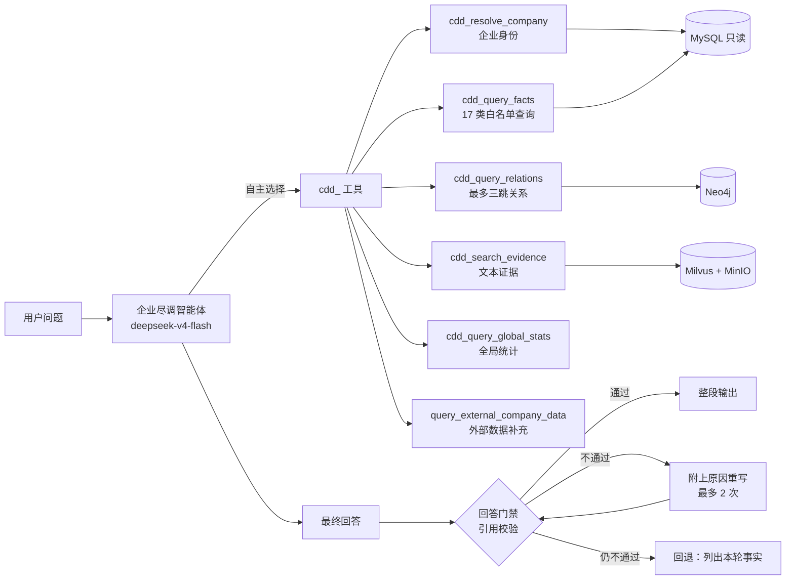

# 企业尽调智能体

企业尽调以平台全局共享 Agent `company-due-diligence`（企业尽调智能体）的形式运行在主聊天中。由模型理解问题、自主选择尽调工具取数、组织回答。回答逐句引用工具结果，**在展示给用户之前先通过来源校验门禁**。问答和尽调报告使用同一条链路：用户要求生成报告时才输出报告，普通提问正常回答。

> 2026-10-22 起，原来的确定性工作流（关键词意图规划 `InvestigationPlanner`、`investigate_company` 工具、问答工作流、十二章节报告任务链路）已经移除。下面两份“逐字稿”保留作历史参考。

## 核心约束

- 广东企业 MySQL 只读接入，是企业事实主库；Neo4j 关系投影和 Milvus 证据索引都是可以重建的派生数据。
- 模型不执行任意 SQL 或 Cypher，只能调用白名单工具。企业事实只能来自本轮工具结果，不能凭模型记忆补充。
- 企业身份只能由 `cdd_resolve_company` 确认，后续工具使用的 `eid` 都来自它。名称有歧义时列出候选，请用户确认。
- 缺失、截断、过期、冲突和来源不可用都要如实说明，不能用自然语言掩盖。

## 架构

## 工具

| 工具 | 封装的领域服务 | 说明 |
| --- | --- | --- |
| `cdd_resolve_company` | `EntityResolutionService` | 名称、信用代码、股票代码、上下文 eid 四选一；歧义时只返回候选 |
| `cdd_query_facts` | `StructuredQueryService` | 17 类白名单 `query_type`；默认返回前 10 条，`list_all` 只对股东类查询开放，且只在用户明确要求“全部”时使用 |
| `cdd_query_relations` | `GraphPathQueryService` | 最多三跳；Neo4j 没有投影时报“来源不可用”，不能当作“没有关系” |
| `cdd_search_evidence` | `EvidenceQueryService` | 绑定单一企业；结果只能作为补充，不能写成确定性结论 |
| `cdd_query_global_stats` | `company_due_diligence/global_stats.py` | 白名单统计：`catalog_coverage`（数据覆盖）、`shared_shareholders`（共同股东） |
| `query_external_company_data` | 外部数据服务（AkShare 等） | 只在内部数据缺失、过期或冲突时补充 |

工具返回的结构化结果保留 `fact_id` / `relation_id` / `path_id` / `evidence_id` 以及来源，并且整段留在上下文中（不会被大结果卸载为文件预览），供回答引用。

## 回答门禁

- **引用格式**：含事实的句子在句末写全角方括号引用，例如 `［F:fact:…］`（R/P/E 分别对应关系、路径、证据）。表格的每一行在最后一个单元格内写引用。
- **校验规则**（`company_due_diligence/answer_gate.py`，`CompanyAnswerGateMiddleware`）：
  - 引用的 ID 必须出现在本轮工具结果中；
  - 被引用事实的值必须出现在同一句中，允许千分位、百分比与小数、万元/亿元与元、日期格式这些写法差异；
  - 事实主体必须属于本轮解析的企业或其关联主体；
  - 只引用证据的句子使用确定性措辞、未引用的句子中出现数字，这两种情况只告警，不拦截。
- **整段输出**：模型调用不逐字推送。运行期间页面显示工具进度，门禁通过（或回退）后整段显示回答。
- **记录**：每次尝试的原文、违规项、告警和 token 用量写入最终消息的 `response_metadata.answer_gate`，供审计和评测使用。

## 尽调报告

只有用户明确要求“尽调报告”“完整报告”或某个专题报告时，Agent 才输出报告。报告就是这一轮的最终回答（Markdown），同样经过门禁。

- 完整报告依次包含以下章节：企业身份、工商与业务概览、股权结构与出资、关联关系、产品与业务线索、融资历程、财务指标、合规/处罚/异常与许可、知识产权、新闻与重大事件、关键风险与待核验事项、数据质量声明。
- 某章没有数据、结果被截断或来源不可用时，在该章如实写明，不省略该章，也不推测补齐。
- 专题报告只写用户点名的章节。

## 评测

- 企业尽调题集（Q-02、Q-03）使用 `agent_run` runner 运行企业尽调智能体，由 `cdd_agent_adapter` 把 Run 转换为企业尽调评分字段：只计入最终回答引用的事实，门禁回退计为没有事实。评分器为 `company-due-diligence-deterministic-v2`。
- 2026-10-22 的结果（本地单次实验，不代表生产准确率）：

| 题集 | 结果 |
| --- | --- |
| Q-02 v4（36 题） | 36/36、35/36 |
| Q-03 改写鲁棒性（60 题） | 59/60 × 2 |

确定性工作流在同样两套题集上的对照结果为 29/36 和 16/60，详见 `docs/vibe/2026-10-22-cdd-agent-stage4b-report.md`。

## 权限与共享

企业尽调智能体全局共享。已有环境在启动时，如果检测到旧的确定性配置（工具中含 `investigate_company`），会一次性迁移为当前配置；之后不再覆盖管理员在配置页做的修改。
