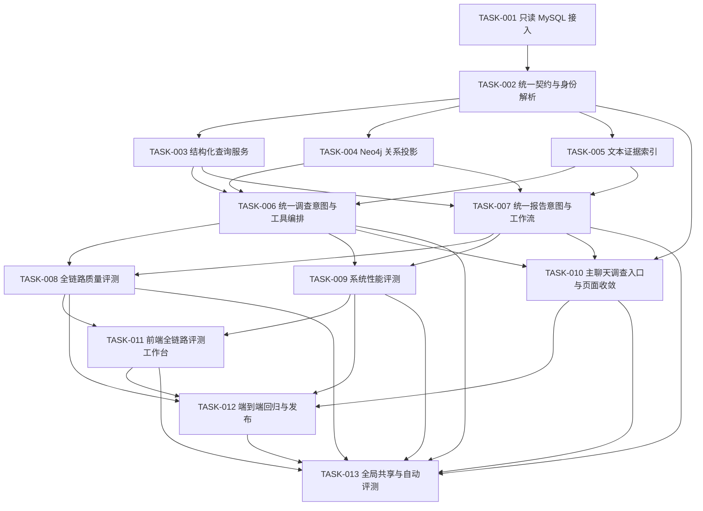

# 企业尽调智能体任务清单

本目录把企业尽调智能体拆成 13 个可独立验收的任务。Wave 1～Wave 6 形成基础版；2026 年 8 月 11 日已按 Wave 7 完成领域智能体统一输入输出升级。Wave 8 进一步改造为全局共享智能体、无企业名称必填和全局自动评测。当前自动链路已完成，正式发布仍受缺少 `human_verified` 广东企业 Golden 阻塞。

实现逐字稿见 [`docs/agents/company-due-diligence-implementation-guide.md`](../../docs/agents/company-due-diligence-implementation-guide.md)，输入、处理、输出和效果证据的完整链路逐字稿见 [`docs/agents/company-due-diligence-end-to-end-script.md`](../../docs/agents/company-due-diligence-end-to-end-script.md)。

## 状态约定

- `待开始`：依赖未满足或尚未开发。
- `可开始`：依赖已满足，可以领取。
- `进行中`：已有负责人正在实现。
- `待验收`：代码和测试已完成，等待整体检查。
- `已完成`：验收标准和测试全部通过。
- `阻塞`：存在明确外部依赖，必须记录阻塞原因。
- `自动验收完成，正式发布阻塞`：代码和自动回归已完成，但仍缺人工业务门禁。

## 总体任务图

## 并行波次

| 波次 | 任务 | 并行规则 | 完成标志 |
| --- | --- | --- | --- |
| Wave 1 | `TASK-001` | 串行起点 | 只读连接池、健康检查和安全测试通过 |
| Wave 2 | `TASK-002` | 依赖 Wave 1 | DTO、来源契约和身份解析冻结 |
| Wave 3 | `TASK-003`、`TASK-004`、`TASK-005` | 三个任务写入范围分离，可并行 | SQL、图谱、文本三种检索服务可独立测试 |
| Wave 4 | `TASK-006`、`TASK-007`、`TASK-010` | 后端调查编排和报告可并行；前端联调依赖后端 | 企业上下文、统一意图、动态输出和主聊天调用可用 |
| Wave 5 | `TASK-008`、`TASK-009`、`TASK-011` | 质量、性能和评测前端可并行；前端联调依赖评测 API | 质量和性能结果可在前端查看与导出 |
| Wave 6 | `TASK-012` | 串行收口 | 关键链路 E2E、回归门禁和文档全部通过 |
| Wave 7 | `TASK-006`、`TASK-007`、`TASK-008`、`TASK-010`、`TASK-011`、`TASK-012` 升级项 | 先冻结意图/响应契约，再并行改后端编排、报告和前端，最后补评测与发布门禁 | 领域智能体统一入口、输入输出一致性和动态展示通过新 Golden |
| Wave 8 | `TASK-013` | 依赖 Wave 7，统一改造 Agent 注册、无企业输入、自动评测和全局性能聚合 | 全局共享智能体、无企业名称必填、自动数据评测和全局性能看板通过回归 |

## 任务索引

| 任务 | 标题 | 类型 | 直接依赖 | 当前状态 |
| --- | --- | --- | --- | --- |
| [`TASK-001`](TASK-001-readonly-mysql-access.md) | 只读 MySQL 接入 | 串行 | 无 | 已完成 |
| [`TASK-002`](TASK-002-canonical-contract-and-entity-resolution.md) | 统一契约与企业身份解析 | 串行 | `TASK-001` | 已完成 |
| [`TASK-003`](TASK-003-structured-query-service.md) | 结构化查询服务 | 并行 | `TASK-002` | 已完成 |
| [`TASK-004`](TASK-004-neo4j-graph-projection.md) | Neo4j 关系投影 | 并行 | `TASK-002` | 已完成 |
| [`TASK-005`](TASK-005-text-evidence-index.md) | 文本证据索引 | 并行 | `TASK-002` | 已完成 |
| [`TASK-006`](TASK-006-question-answering-api.md) | 统一调查意图与工具编排 | 并行 | `TASK-003`、`TASK-004`、`TASK-005` | 已完成；在线 LLM 为非阻塞后续项 |
| [`TASK-007`](TASK-007-due-diligence-report-workflow.md) | 统一报告意图与工作流 | 并行 | `TASK-003`、`TASK-004`、`TASK-005`、升级后的 `TASK-006` 契约 | 已完成 |
| [`TASK-008`](TASK-008-quality-evaluation.md) | 全链路质量评测 | 并行 | `TASK-006`、`TASK-007` | 自动评测升级已完成；人工 Golden 阻塞正式门禁 |
| [`TASK-009`](TASK-009-performance-evaluation.md) | 系统性能评测 | 并行 | `TASK-006`、`TASK-007` | 已完成 |
| [`TASK-010`](TASK-010-frontend-query-and-report.md) | 主聊天调查入口与页面收敛 | 条件并行 | 统一意图/响应契约，联调依赖 `TASK-006`、`TASK-007` | 已完成 |
| [`TASK-011`](TASK-011-frontend-evaluation-workbench.md) | 前端全链路评测工作台 | 条件并行 | `TASK-008`、`TASK-009` API 契约 | 已完成 |
| [`TASK-012`](TASK-012-e2e-regression-and-release.md) | 端到端回归与发布门禁 | 串行收口 | `TASK-006` 至 `TASK-011` | 自动门禁已完成；正式发布受人工 Golden 阻塞 |
| [`TASK-013`](TASK-013-global-shared-auto-evaluation.md) | 全局共享智能体与无企业必填的自动评测 | 横切升级 | `TASK-006` 至 `TASK-012` | 已完成；正式发布仍受人工 Golden 阻塞 |

## 当前验收摘要

截至 2026 年 8 月 11 日：

- 平台启动时幂等注册唯一 slug 为 `company-due-diligence` 的全局共享 Agent，复用 `share_config.access_level=global`，不按用户复制配置。
- `POST /api/company-due-diligence/investigations`、`CompanyDueDiligenceAgent` 和主智能体工具 `investigate_company` 已共用同一领域服务；旧 `/query`、`/reports` 保持兼容。
- 主聊天直接接收自然语言输入；问题可自动提取企业全称、股票代码和信用代码，无企业全局问题返回 `global_scope`，企业依赖问题返回 `needs_context`。
- `/company-due-diligence` 只保留全局质量/性能评测，旧评测路由兼容重定向；查询、关系和报告不再形成独立页面链路。
- 真实目录扫描确认 `924` 家企业，并输出股东、产品、融资、风险、许可、知识产权覆盖和关键字段非空率；自动评测按五类样本族生成 `source_derived` 数据集。
- 性能运行不要求企业引用，自动选样并输出全局分位数、接口/意图/工具链/数据源、连接池和 Tasker 排队等待；最终性能报告不保留企业引用明细。
- `TASK-008` 已增加企业解析、主题、时间、深度、展示、交付、必要/禁止工具、Claim Ledger、主题覆盖和无关主题规避指标；当前没有 `human_verified` 广东企业 Golden，不能冻结正式质量阈值。
- `TASK-012` 与 `TASK-013` 的统一智能体 E2E、无企业自动评测和全局性能回归已完成；发布状态仍为 `blocked`，唯一业务阻塞项是人工 Golden，在线 LLM 未启用作为非阻塞限制展示。
- 最新发布验收报告由 `backend/scripts/company_due_diligence/generate_release_gate.py` 生成到 `saves/company_due_diligence/release/`，生成文件不提交 Git。
- 最新发布验收报告会同时记录 REST 入口、主智能体工具、意图/工具/展示/Claim/输入输出一致性指标和管理员部署态 E2E 状态。

## 公共实现约束

所有任务共同遵守：

1. 广东企业 MySQL 只读，禁止修改、补表和清洗回写。
2. 不新增或重复拉取 MySQL、PostgreSQL、Redis、MinIO、Neo4j、Milvus Docker 镜像。
3. MySQL 是唯一事实主库；Neo4j、Milvus 和快照必须可重建。
4. 不记录密码、Token、完整 DSN、个人明细或可反推连接信息。
5. LLM 不执行任意 SQL，不生成无来源企业事实。
6. 普通用户不填写内部 `eid`，不选择结构化查询、图路径或证据检索等内部工具。
7. `company_ref` 不是查询、评测或性能运行的必填项；企业信息可从自然语言或可选上下文解析。
8. 自然语言报告意图和报告按钮必须归一到同一领域智能体链路。
9. 新增后端函数和类包含凝练中文 docstring，关键约束使用原因型注释。
10. 新增前端 API 统一放在 `web/src/apis`，样式使用 `base.css` 颜色变量。
11. 测试遵守 `docs/develop-guides/testing-guidelines.md`，开发和验证在 Docker 容器中完成。
12. 任务完成时更新 `docs/develop-guides/changelog.md` 和受影响正式文档。

## 公共输出契约

工作台输入、主智能体调用、关系调查和报告统一使用或引用以下对象：

- `CompanyContext`：当前会话中已确认的主企业和其他被提及企业；
- `InvestigationIntent`：主题、时间、深度、展示形式、交付方式和执行约束；
- `UnderstoodRequest`：返回给用户确认的意图摘要；
- `Entity`：企业、股东、投资人、风险事件等主体；
- `Fact`：结构化事实及规范化值；
- `Relation`：有方向、有类型、有来源的关系；
- `Path`：多跳节点和边序列；
- `Evidence`：文本证据片段；
- `Source`：来源表、记录键、业务日期和查询时间；
- `DataQuality`：缺失、过期、冲突和最低置信度；
- `LatencyBreakdown`：身份、MySQL、Neo4j、Milvus、LLM 和总耗时。
- `Presentation`：摘要、列表、关系结果、专题报告或完整报告的动态展示描述；
- `Task`：仅在异步专题报告、完整报告或评测中返回。

当前事实契约在 `TASK-002` 已冻结；智能体意图和展示契约已由 `TASK-006` 冻结。后续修改必须同步更新后端模型、前端类型、Golden 数据和本文依赖说明。

## 并行开发规则

- `TASK-003` 只写 MySQL 结构化查询域。
- `TASK-004` 只写 Neo4j 投影和路径查询域。
- `TASK-005` 只写文本抽取、索引和证据检索域。
- `TASK-006` 组合现有查询服务形成领域智能体，不重写三个底层服务。
- `TASK-007` 复用统一意图实现报告任务、章节聚合和报告产物，不另建身份解析链路。
- `TASK-010` 可以先使用契约 mock，但不得自行发明与后端不同的意图或展示字段。
- `TASK-008` 与 `TASK-009` 使用独立评测命名空间和运行记录，避免互相覆盖。
- `TASK-011` 只消费质量和性能评测 API，不把评测计算放到浏览器。

## 每个任务完成后的检查

- [ ] 任务验收标准全部满足。
- [ ] 相关单元测试通过。
- [ ] 涉及 API 时相关集成测试通过。
- [ ] 涉及关键链路时相关 E2E 测试通过。
- [ ] `make format` 和项目既有 Lint 通过。
- [ ] 日志、接口、测试夹具和文档中无敏感连接信息。
- [ ] 没有增加无关 Docker 服务或重复镜像依赖。
- [ ] README、正式文档和 changelog 已按影响范围更新。
