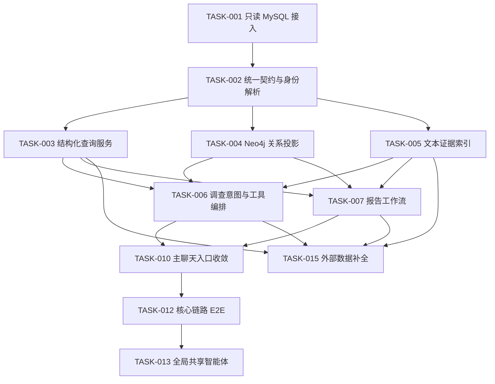

# 企业尽调智能体任务清单

本目录仅维护当前仍存在的企业尽调能力：广东企业 MySQL 只读接入、统一契约、结构化查询、关系图谱、文本证据、自然语言调查、报告、主聊天入口、核心回归、全局共享智能体和外部数据补全。

企业尽调专属质量评测、QA Benchmark、性能评测、评测页面和发布门禁已经删除，不再作为后续任务依赖。通用知识库 RAG 评测和企业关系评测属于其他模块，不受本次调整影响。

## 任务关系

## 任务索引

| 任务 | 内容 | 状态 |
| --- | --- | --- |
| [`TASK-001`](TASK-001-readonly-mysql-access.md) | 只读 MySQL 接入 | 已完成 |
| [`TASK-002`](TASK-002-canonical-contract-and-entity-resolution.md) | 统一契约与企业身份解析 | 已完成 |
| [`TASK-003`](TASK-003-structured-query-service.md) | 结构化查询服务 | 已完成 |
| [`TASK-004`](TASK-004-neo4j-graph-projection.md) | Neo4j 关系投影 | 已完成 |
| [`TASK-005`](TASK-005-text-evidence-index.md) | 文本证据索引 | 已完成 |
| [`TASK-006`](TASK-006-question-answering-api.md) | 调查意图与工具编排 | 已完成 |
| [`TASK-007`](TASK-007-due-diligence-report-workflow.md) | 报告工作流 | 已完成 |
| [`TASK-010`](TASK-010-frontend-query-and-report.md) | 主聊天入口与页面收敛 | 已完成 |
| [`TASK-012`](TASK-012-e2e-regression-and-release.md) | 企业尽调核心链路端到端回归 | 已完成 |
| [`TASK-013`](TASK-013-global-shared-agent.md) | 全局共享智能体与自然语言企业上下文 | 已完成 |
| [`TASK-015`](TASK-015-external-company-data-fallback.md) | 外部数据补全与来源追溯 | 已完成基础链路 |

## 公共约束

1. 广东企业 MySQL 保持只读，禁止修改、补表和清洗回写。
2. MySQL 是内部事实主库；Neo4j、Milvus 和外部缓存必须可重建。
3. 用户只需要自然语言问题，不要求填写内部 `eid` 或选择查询引擎。
4. 所有事实、关系、路径和证据必须具有可回查的 `source_id`。
5. 外部来源只能补充、对照或解释数据缺口，不能静默覆盖内部事实。
6. 简单问答、关系调查和报告统一复用 `CompanyDueDiligenceAgent.investigate`。
7. 企业尽调不提供独立工作台，用户从主聊天选择全局智能体。
8. 测试按 `backend/test/unit`、`integration`、`e2e` 分层，并在 Docker 容器中执行。

## 删除说明

- 已删除企业尽调专属 `/api/company-due-diligence/evaluations/*` 接口。
- 已删除质量评测、QA Benchmark、性能评测、评估标准、候选题和结果页面。
- 已删除对应运行脚本、发布门禁脚本及专项测试。
- PostgreSQL 中历史评测表和数据没有执行 `DROP` 或 `DELETE`，但当前代码不再映射或使用这些表。
