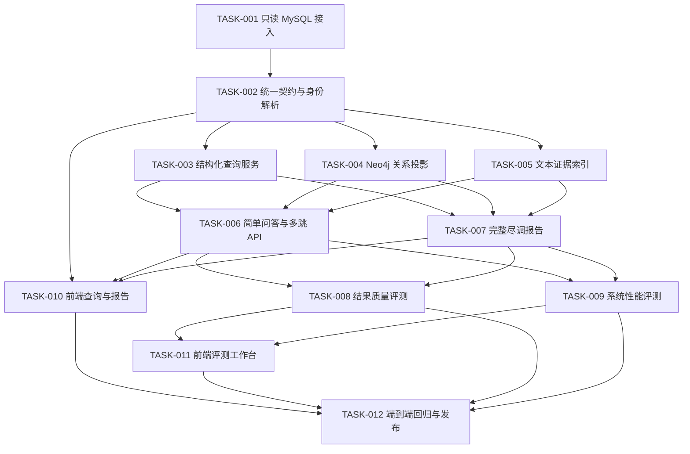

# 企业尽调智能体任务清单

本目录把企业尽调智能体拆成 12 个可独立验收的任务。任务可以按波次并行，但不能跳过依赖；每个任务完成后都要更新本文件状态，并在 Docker 容器中执行对应检查、测试和 Lint。

实现逐字稿见 [`docs/agents/company-due-diligence-implementation-guide.md`](../../docs/agents/company-due-diligence-implementation-guide.md)。

## 状态约定

- `待开始`：依赖未满足或尚未开发。
- `可开始`：依赖已满足，可以领取。
- `进行中`：已有负责人正在实现。
- `待验收`：代码和测试已完成，等待整体检查。
- `已完成`：验收标准和测试全部通过。
- `阻塞`：存在明确外部依赖，必须记录阻塞原因。

## 总体任务图

## 并行波次

| 波次 | 任务 | 并行规则 | 完成标志 |
| --- | --- | --- | --- |
| Wave 1 | `TASK-001` | 串行起点 | 只读连接池、健康检查和安全测试通过 |
| Wave 2 | `TASK-002` | 依赖 Wave 1 | DTO、来源契约和身份解析冻结 |
| Wave 3 | `TASK-003`、`TASK-004`、`TASK-005` | 三个任务写入范围分离，可并行 | SQL、图谱、文本三种检索服务可独立测试 |
| Wave 4 | `TASK-006`、`TASK-007`、`TASK-010` | 后端问答和报告可并行；前端先按冻结契约 mock，联调依赖后端 | 简单问答、多跳、报告和前端主工作台可用 |
| Wave 5 | `TASK-008`、`TASK-009`、`TASK-011` | 质量、性能和评测前端可并行；前端联调依赖评测 API | 质量和性能结果可在前端查看与导出 |
| Wave 6 | `TASK-012` | 串行收口 | 关键链路 E2E、回归门禁和文档全部通过 |

## 任务索引

| 任务 | 标题 | 类型 | 直接依赖 | 初始状态 |
| --- | --- | --- | --- | --- |
| [`TASK-001`](TASK-001-readonly-mysql-access.md) | 只读 MySQL 接入 | 串行 | 无 | 可开始 |
| [`TASK-002`](TASK-002-canonical-contract-and-entity-resolution.md) | 统一契约与企业身份解析 | 串行 | `TASK-001` | 待开始 |
| [`TASK-003`](TASK-003-structured-query-service.md) | 结构化查询服务 | 并行 | `TASK-002` | 待开始 |
| [`TASK-004`](TASK-004-neo4j-graph-projection.md) | Neo4j 关系投影 | 并行 | `TASK-002` | 待开始 |
| [`TASK-005`](TASK-005-text-evidence-index.md) | 文本证据索引 | 并行 | `TASK-002` | 待开始 |
| [`TASK-006`](TASK-006-question-answering-api.md) | 简单问答与多跳 API | 并行 | `TASK-003`、`TASK-004`、`TASK-005` | 待开始 |
| [`TASK-007`](TASK-007-due-diligence-report-workflow.md) | 完整尽调报告工作流 | 并行 | `TASK-003`、`TASK-004`、`TASK-005` | 待开始 |
| [`TASK-008`](TASK-008-quality-evaluation.md) | 结果质量评测 | 并行 | `TASK-006`、`TASK-007` | 待开始 |
| [`TASK-009`](TASK-009-performance-evaluation.md) | 系统性能评测 | 并行 | `TASK-006`、`TASK-007` | 待开始 |
| [`TASK-010`](TASK-010-frontend-query-and-report.md) | 前端查询与报告工作台 | 条件并行 | `TASK-002` 契约，联调依赖 `TASK-006`、`TASK-007` | 待开始 |
| [`TASK-011`](TASK-011-frontend-evaluation-workbench.md) | 前端评测工作台 | 条件并行 | `TASK-008`、`TASK-009` API 契约 | 待开始 |
| [`TASK-012`](TASK-012-e2e-regression-and-release.md) | 端到端回归与发布门禁 | 串行收口 | `TASK-006` 至 `TASK-011` | 待开始 |

## 公共实现约束

所有任务共同遵守：

1. 广东企业 MySQL 只读，禁止修改、补表和清洗回写。
2. 不新增或重复拉取 MySQL、PostgreSQL、Redis、MinIO、Neo4j、Milvus Docker 镜像。
3. MySQL 是唯一事实主库；Neo4j、Milvus 和快照必须可重建。
4. 不记录密码、Token、完整 DSN、个人明细或可反推连接信息。
5. LLM 不执行任意 SQL，不生成无来源企业事实。
6. 新增后端函数和类包含凝练中文 docstring，关键约束使用原因型注释。
7. 新增前端 API 统一放在 `web/src/apis`，样式使用 `base.css` 颜色变量。
8. 测试遵守 `docs/develop-guides/testing-guidelines.md`，开发和验证在 Docker 容器中完成。
9. 任务完成时更新 `docs/develop-guides/changelog.md` 和受影响正式文档。

## 公共输出契约

简单问答、多跳查询和报告统一返回或引用以下对象：

- `Entity`：企业、股东、投资人、风险事件等主体；
- `Fact`：结构化事实及规范化值；
- `Relation`：有方向、有类型、有来源的关系；
- `Path`：多跳节点和边序列；
- `Evidence`：文本证据片段；
- `Source`：来源表、记录键、业务日期和查询时间；
- `DataQuality`：缺失、过期、冲突和最低置信度；
- `LatencyBreakdown`：身份、MySQL、Neo4j、Milvus、LLM 和总耗时。

公共契约在 `TASK-002` 冻结。后续任务如需修改，必须同步更新后端模型、前端类型、Golden 数据和本文依赖说明。

## 并行开发规则

- `TASK-003` 只写 MySQL 结构化查询域。
- `TASK-004` 只写 Neo4j 投影和路径查询域。
- `TASK-005` 只写文本抽取、索引和证据检索域。
- `TASK-006` 只组合查询服务并开放问答 API，不重写三个底层服务。
- `TASK-007` 只实现报告任务、章节聚合和报告产物。
- `TASK-010` 可以先使用契约 mock，但不得自行发明与后端不同的字段。
- `TASK-008` 与 `TASK-009` 使用独立评测命名空间和运行记录，避免互相覆盖。
- `TASK-011` 只消费质量和性能评测 API，不把评测计算放到浏览器。

## 每个任务完成后的检查

- [ ] 任务验收标准全部满足。
- [ ] 相关单元测试通过。
- [ ] 涉及 API 时相关集成测试通过。
- [ ] 涉及关键链路时相关 E2E 测试通过。
- [ ] `make format` 和项目既有 Lint 通过。
- [ ] 日志、接口、测试夹具和文档中无敏感连接信息。
- [ ] 没有增加无关 Docker 服务或重复镜像依赖。
- [ ] README、正式文档和 changelog 已按影响范围更新。
